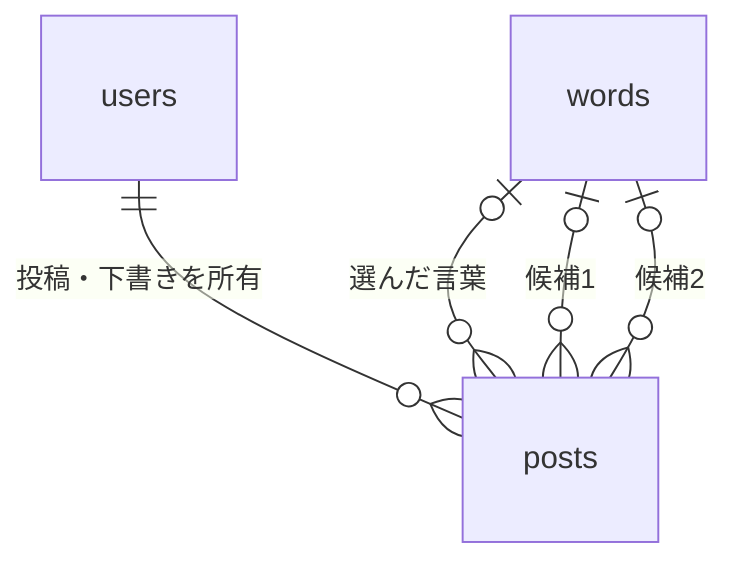

# データベース設計：平泉の細道

作成日：2026-10-12

## 1. 前提と決定事項

`requirements.md`、`routes.md` と、その後の会話に基づく設計。開発時はSQLite、操作にはPeeweeを使う。本書は設計のみで、モデル・SQL・DBファイルは作成しない。

- ログイン用ユーザー名を投稿者名として公開する。ニックネームで登録できる。
- 写真は1投稿1枚。撮影場所は「中尊寺」「毛越寺」「その他」。「その他」では具体的な場所名を任意入力できる。
- 30件から始める言葉は、後からExcelで追加・修正・抽選停止を指定して取り込める。件数を30に固定しない。
- 言葉・読み方・出典の訂正は過去の投稿にも反映する。投稿者のひとことは変えない。
- 別の言葉への入れ替えは、旧言葉を停止し、新しい番号で追加する。旧言葉自体は削除しない。
- 手動保存の下書きは1人1件。本人のみ閲覧・編集でき、再開時に写真・場所・候補2件・選択・ひとことを復元する。
- 下書きで選択済みの言葉が停止されても、そのまま投稿可能。新しい抽選には停止中の言葉を出さない。
- 公開済み投稿の削除は投稿データと写真の完全削除。ごみ箱・復元機能は作らない。
- 読み取りはGET、変更はPOST。認証と所有者確認はFlask側でも行う。

以下の文字数上限は、300文字のひとことを除き設計上の初期値。Excelの実データを確認して必要なら調整する。長い文章を無断で切り詰めない。

## 2. 初版のテーブル一覧

| テーブル | Peeweeモデル名 | 必要な理由 |
|---|---|---|
| `users` | `User` | ログイン情報を保存し、投稿や下書きの所有者を特定する。 |
| `words` | `Word` | 言葉・説明案・出典を一元管理し、抽選候補の有効／停止を管理する。 |
| `posts` | `Post` | 写真投稿と下書きを同じ構成で保存し、状態を変えて公開する。 |

下書き専用テーブル、写真専用テーブル、全抽選履歴のテーブルは初版では不要。場所は固定の3種類なので専用テーブルを作らない。DBには画像そのものではなく保存先を示すキーを記録する。

## 3. 型・必須項目の読み方

- 主キー（PK）：各行を一意に識別する番号。
- 外部キー（FK）：他テーブルの主キーを参照する列。
- 必須：NULL不可。文字列は必要に応じて空文字も禁止する。
- 任意：NULL可。「未入力」はNULLに統一する。ひとことだけは未入力を空文字で扱う。
- 条件付き：下書きでは任意、公開時は必須など、状態で変わる。
- 日時：UTCの日時として統一保存し、画面では日本時間に変換する。SQLite側にタイムゾーンの自動処理は期待しない。
- VARCHAR・TEXTは文字列、INTEGERは整数、DATETIMEは日時を表す。SQLiteでは宣言した型や文字数だけに依存せず、CHECKとアプリの検証を併用する。

## 4. users：利用者

| カラム名 | 論理／DB型 | Peeweeの型 | 必須・任意 | キー・初期値・用途 |
|---|---|---|---|---|
| `id` | INTEGER | AutoField | 必須 | PK、自動採番。 |
| `username` | VARCHAR(30) | CharField | 必須 | UNIQUE。ログイン名兼公開ニックネーム。 |
| `password_hash` | TEXT | TextField | 必須 | パスワード用ハッシュ文字列。平文パスワードは保存しない。 |
| `created_at` | DATETIME | DateTimeField | 必須 | 登録時のUTC日時。 |

### 制約と扱い

- `username`：前後の空白を除去し、1〜30文字。DBでも長さと空文字をCHECKする。
- 登録・ログインの両方で同じ正規化（Unicode NFKC、前後空白除去）を行い、正規化後の名前を保存する。初版では英字の大文字・小文字を区別する。
- 名前の重複は事前確認だけでなくUNIQUEで防ぎ、同時登録時の競合も処理する。
- `password_hash`は空文字不可。パスワードそのものの長さ・強度は保存前にアプリで検証する。
- 初版ではユーザー名変更・退会・メールアドレス登録・公開プロフィールを追加しない。

## 5. words：言葉の一覧

| カラム名 | 論理／DB型 | Peeweeの型 | 必須・任意 | キー・初期値・用途 |
|---|---|---|---|---|
| `id` | INTEGER | AutoField | 必須 | PK、DB内の番号。 |
| `word_code` | INTEGER | IntegerField | 必須 | UNIQUE、1以上。Excelの固定番号に対応。行番号とは別。 |
| `phrase` | VARCHAR(100) | CharField | 必須 | 言葉の表記。 |
| `reading` | VARCHAR(150) | CharField | 必須 | 読み方。 |
| `explanation` | TEXT | TextField | 必須 | 意味・解説。 |
| `suggested_caption` | VARCHAR(300) | CharField | 必須 | 写真に添える文章案。 |
| `source_label` | VARCHAR(200) | CharField | 必須 | 「出典：『涅槃経』」「〜に基づく」等、言葉の横の表示。 |
| `reference_name` | VARCHAR(200) | CharField | 必須 | 「薬師寺」など確認先名称。 |
| `reference_url` | TEXT | TextField | 必須 | 確認済みページのURL。 |
| `is_active` | INTEGER（真偽値） | BooleanField | 必須 | 初期値は偽。確認を終えた言葉だけ真にする。 |
| `created_at` | DATETIME | DateTimeField | 必須 | 初回登録日時。 |
| `updated_at` | DATETIME | DateTimeField | 必須 | 内容変更・抽選停止等の更新日時。 |

### 制約と扱い

- `word_code`は正の整数で重複不可。並べ替え・削除による番号の振り直しや使い回しは禁止。
- `phrase`そのものにはUNIQUEを設けない。異なる出典の同じ表記もあり得るため、取り込み時に重複候補として確認する。
- 各必須文字列は空文字・空白だけを禁止。上限がある列には長さのCHECKを設ける。空白の細かな判定はアプリでも行う。
- `is_active`は0または1に限定。URLがない未確認行は初版の本テーブルへ取り込まず、Excelで補完する。
- URLの形式・HTTP/HTTPS・リンク先の適切さはアプリと運営者が確認する。CHECKだけで外部ページの正しさは保証できない。
- 停止は`is_active`を偽にするだけであり、行の削除ではない。
- 投稿表示では言葉テーブルの最新の表記・読み方・出典を参照する。停止中でも過去投稿の表示から除外しない。
- 文章案が訂正されても、既存の`posts.caption`は更新しない。

## 6. posts：写真投稿・下書き

| カラム名（DB） | 論理／DB型 | Peeweeの型・参照先 | 必須・任意 | キー・初期値・用途 |
|---|---|---|---|---|
| `id` | INTEGER | AutoField | 必須 | PK、自動採番。 |
| `user_id` | INTEGER | ForeignKeyField → User | 必須 | FK → users.id、投稿者。 |
| `status` | VARCHAR(10) | CharField | 必須 | `draft`または`published`。初期値`draft`。 |
| `image_key` | VARCHAR(255) | CharField | 条件付き | UNIQUE。画像保存先の相対キー。下書きはNULL可、公開時必須。 |
| `location` | VARCHAR(20) | CharField | 条件付き | `chusonji`・`motsuji`・`other`。下書きはNULL可。 |
| `location_other` | VARCHAR(100) | CharField | 任意 | 「その他」の具体的な場所名。 |
| `word_id` | INTEGER | ForeignKeyField → Word | 条件付き | FK → words.id、選んだ言葉。下書きはNULL可、公開時必須。 |
| `candidate_word_1_id` | INTEGER | ForeignKeyField → Word | 任意 | FK → words.id、保存した候補1。 |
| `candidate_word_2_id` | INTEGER | ForeignKeyField → Word | 任意 | FK → words.id、保存した候補2。 |
| `caption` | VARCHAR(300) | CharField | 必須（下書きは空文字可） | 初期値は空文字。投稿者が編集したひとこと。 |
| `version` | INTEGER | IntegerField | 必須 | 初期値1。保存・公開・編集成功ごとに1増やす。 |
| `submission_key` | VARCHAR(36) | CharField | 必須 | UNIQUE。投稿を識別するUUID文字列。再送による重複を防ぐ。 |
| `created_at` | DATETIME | DateTimeField | 必須 | 初めてDBに保存した日時。 |
| `updated_at` | DATETIME | DateTimeField | 必須 | 最後に保存・公開・編集した日時。 |
| `published_at` | DATETIME | DateTimeField | 条件付き | 下書きはNULL、公開時に設定。公開後の編集では変更しない。 |

### 場所と写真の扱い

- 表示名は`chusonji`→「中尊寺」、`motsuji`→「毛越寺」、`other`→「その他」。
- `other`で具体名があれば具体名を表示し、なければ「その他」。選択を別の場所に変えたときは具体名をNULLにする。
- `image_key`は利用者の元ファイル名や絶対パスではなく、サーバーが生成する重複しない名前。
- 画像は非公開の保存領域に置く。`/media/<post_id>`で公開状態・本人かを確認して配信する。
- 写真本体はDBに入れない。画像データ専用のBLOB列は作らない。

## 7. 主キー・外部キー・関係

| 外部キー | 参照先 | 削除時 | 理由 |
|---|---|---|---|
| posts.user_id | users.id | RESTRICT | 投稿を持つユーザーの誤削除を防ぐ。退会は初版対象外。 |
| posts.word_id | words.id | RESTRICT | 過去の投稿に添えた言葉を失わない。 |
| posts.candidate_word_1_id | words.id | RESTRICT | 下書きの候補を復元できるようにする。 |
| posts.candidate_word_2_id | words.id | RESTRICT | 同上。 |

主キーは後から変更しない。更新時も参照先の番号変更を禁止する方針。言葉の修正は同じ行の本文を変更する。

- 1ユーザーは複数の公開投稿を持てるが、下書きは最大1件。
- 1つの言葉は複数の投稿・下書きに使える。
- 下書きでは選んだ言葉が0件でもよいが、公開時は必ず1件。
- 候補は0件か2件。初版は必ず2件抽選するため、専用の候補テーブルを増やさず外部キー2列で扱う。

## 8. ユニーク制約

| 対象 | 制約 | 防ぐこと |
|---|---|---|
| users.username | UNIQUE | 同名アカウントの登録。 |
| words.word_code | UNIQUE | Excelの同じ番号を別の言葉として重複登録。 |
| posts.image_key | UNIQUE（NULL可） | 1つの画像を複数投稿で共有して削除時に壊れる問題。 |
| posts.submission_key | UNIQUE | 同じ投稿送信による重複保存。 |
| posts.user_id（statusがdraftの行だけ） | 条件付きUNIQUEインデックス | 同時操作で下書きが2件できる問題。 |

重要：`user_id`単体を通常のUNIQUEにはしない。また、`user_id`と`status`の組み合わせをUNIQUEにすると、公開投稿まで1人1件に制限してしまうため採用しない。

## 9. チェック制約

以下はDBで守るルール。SQLコードは実装時に作成する。

| 対象 | CHECKの内容 |
|---|---|
| words.word_code | 1以上。 |
| words.is_active | 0または1。 |
| posts.status | draftまたはpublishedのみ。 |
| posts.version | 1以上。 |
| posts.location | NULLまたはchusonji・motsuji・other。 |
| posts.location_other | NULL、またはlocationが明示的にotherで、1〜100文字。 |
| 候補2列 | 両方NULL、または両方非NULLかつ異なるID。片方だけは不可。 |
| 選んだ言葉 | word_idが非NULLなら候補2列も非NULLで、そのいずれかと一致する。公開後も候補を保持する。 |
| caption | 下書きでも300文字以内。 |
| 公開時の必須項目 | publishedならimage_key・location・word_id・published_atが非NULL、image_keyとcaptionが空白だけでない。 |
| 下書きの公開日時 | draftならpublished_atはNULL。 |
| 日時 | updated_atはcreated_at以降。published_atがあればcreated_at以降かつupdated_at以前。 |
| 文字列 | 各表に記した長さ・空文字禁止を反映する。submission_keyは36文字、image_keyは非NULLなら1〜255文字。 |

SQLiteのCHECKは式の結果がNULLでも通るため、「公開なら必須」「その他の場合だけ」等は明示的なNULL判定を含める。文字列の前後空白除去やUnicode空白の判定はアプリ側でも行う。

### CHECKだけでは守れないこと

- 他人の投稿を変更しないことは認証と所有者確認で守る。
- 候補に選ばれた証明は署名付き抽選情報で検証する。外部キーだけでは任意の言葉の選択を防げない。
- `is_active`の確認、停止前に下書きで選ばれていたかの判定は、言葉テーブルと更新前の下書きを見て判断する。
- 公開後のword_id固定、公開済みから下書きへ戻さないことは、更新対象列の制限と状態確認で守る。
- URLの安全性、画像形式・5MB上限・実ファイルの存在は保存処理で検証する。

## 10. インデックス候補

| 対象 | 優先度 | 目的 |
|---|---|---|
| 各PKとUNIQUE対象 | 初版必須 | 重複防止とID・ユーザー名・Excel番号・送信キーの検索。既存の自動索引と重ねない。 |
| posts.user_id、条件status=draft | 初版必須 | 1人1件の下書き保証と取得。部分UNIQUEインデックス。 |
| posts(status, published_at降順, id降順) | 初版推奨 | 公開投稿の新しい順・10件表示。 |
| posts.user_id | 初版推奨 | 投稿者に紐づく投稿の取得。外部キーの索引と重複しないよう確認。 |
| posts.word_id、候補のFK2列 | 初版のFK索引 | 言葉からの参照確認。Peeweeが作る索引を確認する。 |
| posts(location, published_at降順, id降順)、公開済みのみ | 将来 | 場所絞り込みを追加してから検討。 |

30件程度のwords.is_activeには専用索引を急いで作らない。実際の件数や検索速度を見て追加する。

## 11. 保存・抽選・公開のルール

### 下書き保存

1. 認証済みユーザーと対象下書きの所有者を確認する。
2. 初回保存ではsubmission_keyを作業中のフォームの識別子として使用する。GETでDB行は作らない。
3. 入力済みの項目だけを検証する。画像・言葉・場所の未入力は許可する。
4. 新しい下書きは条件付きUNIQUEで1人1件を保証する。別の下書きが既にあれば409とする。
5. 更新はID・user_id・status・versionが一致する場合だけ行い、versionを1増やす。更新行が0なら競合として扱う。
6. 保存成功後のみ保存済み表示にする。版番号・日時・画像キーも一緒に更新する。

### 抽選停止と下書きの例外

- 新しい抽選はis_activeが真の言葉だけから、直前の候補2件を除いて選ぶ。
- 対象が2件未満なら抽選を行わず503。選択済みの内容は壊さない。
- 停止中の言葉は、新たな選択としての保存・公開を受け付けない。
- 例外として、DB上の本人の下書きに既にword_idとして保存されている言葉は、停止後もその選択を維持したまま保存・公開できる。
- 候補に出ただけで未選択だった停止語には、この例外を適用しない。再開時に選択不可として表示し、引き直しを案内する。
- 保存前に選択しただけで、その後停止された言葉は例外対象外。再選択が必要だが、写真・ひとことは保持する。
- 下書きで停止語から別の言葉へ変更し保存した後は、旧停止語を再び選択する権利は保持しない。
- 停止判定と保存は同じトランザクション内で行い、運営者の停止操作との競合を防ぐ。

### 公開と重複防止

- 公開前に条件付き必須項目を確認する。
- 下書きからの公開では同じID・submission_keyのままstatusを変更し、published_atを設定する。
- 下書きなしの直接投稿でもsubmission_keyを受け取り、1回だけ公開行を作る。
- 同じキーが既に公開済みなら所有者を確認し、既存投稿の結果を返す。古い内容で上書きしない。
- 公開後に古い下書き保存が来ても、状態とversionの確認で拒否する。
- 削除済み投稿を古い画面から再送して復活させないよう、送信キーをサーバー側の一回限りのフォーム状態でも管理する。初版の再送保証は同一ログイン中の有効なフォームを対象とする。削除後も永続的に再送履歴を保証する仕組みは初版に追加しない。

### 完全削除と画像差し替え

- 本人の公開投稿だけ削除できる。行を残す論理削除や復元画面は設けない。
- 投稿削除でusers・wordsは削除しない。
- DBと画像保存領域は同一トランザクションにはできない。DBコミット後に不要画像を削除し、失敗したファイルはキーを運用ログに記録して再削除する。非公開保存領域のため、投稿行が消えた画像は配信できない。
- 画像差し替えは新画像を保存してDBを更新し、コミット後に旧画像を削除する。DB更新失敗なら新画像を片づける。
- 正常終了時は投稿行・写真とも削除済み。画像削除失敗を成功として隠さず、運営側で確実に回収する。
- バックアップ内の残存データは保存期限に従って消去する。バックアップは利用者向け復元機能ではない。

## 12. Excelからの取り込み

1. ユーザーが編集した最新版Excelを確認し、バックアップを取る。
2. 固定番号（word_code）・言葉・読み方・解説・文章案・出典表示名・確認先名称・確認先URL・抽選対象の列を対応づける。
3. 「確認元」だけの列は、出典表示名と確認先名称を人が確認して分ける。URLは確認して補う。
4. 全行を検証し、番号重複・必須項目不足・文章案300文字超過等を行番号とともに報告する。
5. 既存番号は更新、新番号は追加する。ファイルから消えた行を自動削除・自動停止しない。
6. 入れ替えでは旧番号を停止、新番号で追加する。同じ言葉の誤字訂正には既存番号を使う。
7. 更新前後の差分を確認してから、まとめて反映する。エラー時に一部だけ反映しない。
8. 投稿のcaption・選択したword_id・候補IDは取り込みで書き換えない。

Excelの固定番号とDBのidを分離することで、並び順が変わっても投稿との関係が壊れない。ユーザー用のアップロード画面や言葉編集画面は初版に作らず、運営者が実行する取り込み手順として用意する。

## 13. 将来追加するテーブル（初版では作らない）

| テーブル・用途 | 主なカラムと型 | キー・制約・関係 |
|---|---|---|
| likes：いいね | id INTEGER、user_id INTEGER、post_id INTEGER、created_at DATETIME。全て必須。 | idがPK。user_id→users、post_id→postsのFK。同じ(user_id, post_id)はUNIQUE。post_idに索引。投稿削除時は関連いいねも削除。 |
| comments：コメント | id INTEGER、user_id INTEGER、post_id INTEGER、body VARCHAR(200)、created_at DATETIME。全て必須。 | idがPK。user_id→users、post_id→postsのFK。本文は1〜200文字・空白のみ不可。同じ文章の重複は禁止しない。(post_id, created_at, id)に索引。投稿削除時は関連コメントも削除。 |

将来の2テーブルでは、対象が公開投稿かをアプリで検証する。本人の操作制限や管理者の削除運用も追加時に決める。場所による絞り込みは既存posts.locationで対応でき、新テーブルは不要。

## 14. Peeweeで実装するときの注意点

- テーブル名と列名を明示し、本書と合わせる。外部キーのモデル属性はuser・word等とし、DB列のuser_id・word_idとの混同を避ける。
- wordsを3か所から参照するため、それぞれ別のbackref名を付ける。一覧では選択した言葉だけを結合する。
- 外部キー・NULL・UNIQUE・CHECKはモデルにも反映する。choicesは選択肢の情報でありDBの制約の代用にはならない。[Peewee公式：Models and Fields](https://docs.peewee-orm.com/en/latest/peewee/models.html)
- SQLiteは接続ごとにforeign_keysを有効にする。文字数上限も宣言だけに頼らず検証する。[Peewee公式：Models and Fields](https://docs.peewee-orm.com/en/latest/peewee/models.html)
- 条件付きUNIQUEインデックスは通常のunique指定だけでは作れない。使用するPeewee版で部分インデックスの作成方法を確認し、SQLiteでパラメータ化できない条件は固定のDDLとして扱う。ユーザー入力をDDLへ埋め込まない。[Peewee公式：Models and Fields](https://docs.peewee-orm.com/en/latest/peewee/models.html)
- 日時の初期値は保存時に評価する。updated_atは更新処理で明示的に更新し、defaultだけに任せない。[Peewee公式：Models and Fields](https://docs.peewee-orm.com/en/latest/peewee/models.html)
- version照合と増加は単一の条件付き更新で行う。読み出し後に無条件saveする方式では競合を防げない。
- 保存・公開・Excel反映はatomicによるトランザクションを使う。SQLiteの書き込みトランザクションは短くし、必要に応じてIMMEDIATEを使う。画像の重い検証はロック取得前に済ませる。[Peewee公式：Database](https://docs.peewee-orm.com/en/latest/peewee/database.html)
- 制約違反のIntegrityErrorを捕捉し、ユーザー名重複は422、下書き競合は409等に変換する。トランザクションをロールバックした後に案内する。
- Flaskのリクエスト開始時に接続を開き、終了時に閉じる。接続を複数スレッドで直接共有しない。[Peewee公式：Database](https://docs.peewee-orm.com/en/latest/peewee/database.html)
- 一覧は公開状態で絞り、公開日時・IDの降順で10件取得する。Userと選択Wordを結合し、投稿ごとの追加問い合わせを避ける。
- create_tablesだけで既存列や制約が更新されるとは考えない。変更時はバックアップを取り、マイグレーション手順を用意する。
- 正確な制約構文は実装環境のPeewee・SQLite版で確認する。初版のDB作成後は実際のテーブル・索引定義を点検する。

## 15. 実装時の確認項目

- 別ユーザーは同じ言葉を使えるが、同じユーザー名は登録できない。
- 同時に下書き保存しても1人1件、公開投稿は複数件作れる。
- 写真なし等の下書きは保存できるが、必須不足の公開はできない。
- 候補が重複する行、候補外の選択、不正な場所コードは拒否される。
- 停止中の言葉は新規抽選に出ない。既に下書きで選択済みなら投稿できる。
- words訂正は過去投稿に反映されるが、captionは変わらない。
- 「その他」の具体名が任意で保存でき、別の場所へ変更したら消える。
- 同じ送信キーの再送や古いversionの更新で、重複・上書きが起きない。
- 投稿削除で画像も消え、言葉とユーザーは残る。
- 初版ではlikes・commentsテーブルを作らない。

## 追加仕様：利用者ごとの抽選記録（2026-10-13）

初版に `word_draw_states`（WordDrawState）を追加する。投稿と独立して記録し、ログアウト・投稿削除でも保持する。

|カラム|型|制約・目的|
|---|---|---|
|user_id|INTEGER|PKかつusersへのFK、CASCADE。利用者に0または1行|
|seen_ids|TEXT|必須、既定値`[]`。現在の巡で出したWord IDのJSON配列|
|last_ids|TEXT|必須、既定値`[]`。直前の2件のWord IDのJSON配列|
|cycle|INTEGER|必須、既定値1、CHECK >= 1。何巡目か|

配列のIDは外部キー制約ではなく、抽選時に有効なwordsとの照合で扱う。user_idの主キー索引以外は不要。IMMEDIATEトランザクション内で読み取り・抽選・更新し、並行する抽選の重複を防ぐ。既存3テーブルの変更はなく、バックアップ後のCREATE TABLEで追加する。
